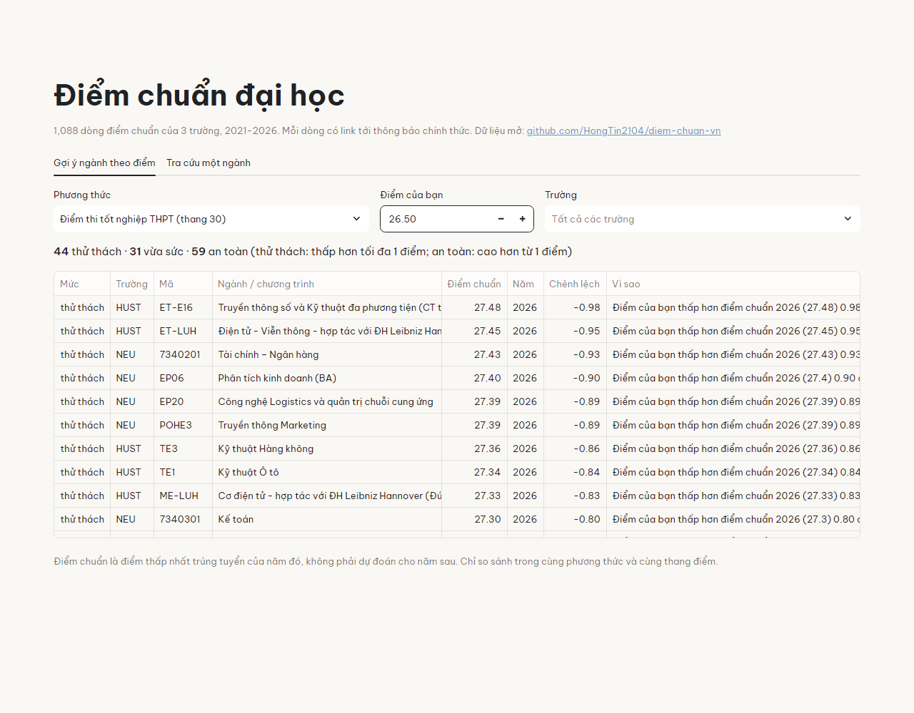
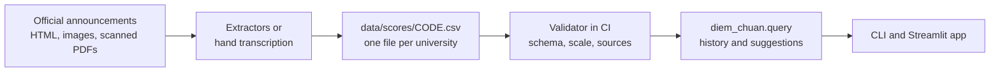
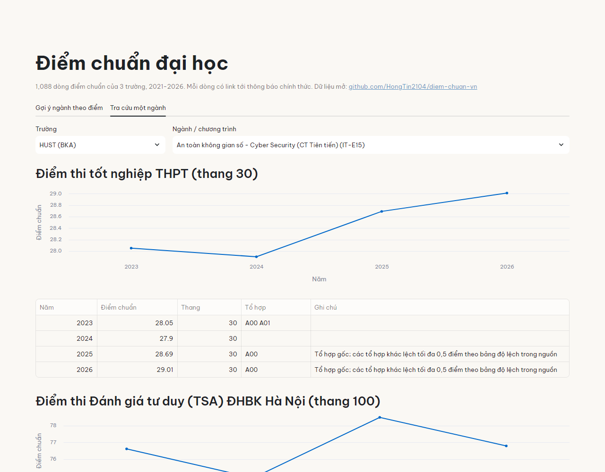

# diem-chuan-vn

[](https://github.com/HongTin2104/diem-chuan-vn/actions/workflows/ci.yml)
[](data/DATASET.md#license)
[](LICENSE)
[](https://diem-chuan-vn.streamlit.app/)
[](https://huggingface.co/datasets/HongTin2104/diem-chuan-vn)

Open, multi-year dataset of Vietnamese university admission cut-off scores (điểm chuẩn), where
every row links to the university's own announcement, plus a small tool that suggests programmes
for a given score and says why.

**Try it online:** https://diem-chuan-vn.streamlit.app/



## The problem

Every August about a million students and their parents look up cut-off scores. The numbers are
spread over university websites, mostly as images or scanned PDFs, and change format every year.
Aggregator sites have them but do not let anyone reuse the data, and the open repositories on
GitHub cover one year, stop in 2018, or do not say where the numbers came from.

Comparing years is harder than it looks: admission methods and scales change. UIT moved to a single
100-point combined score in 2026, HUST publishes one score per programme for a base subject group
plus a table of offsets, NEU publishes one score converted to the 30-point scale for every method.
A single "điểm chuẩn" column hides all of this.

## Data

| University | Years | Rows | Programmes | Methods |
|---|---|---|---|---|
| HUST (BKA) | 2023-2026 | 784 | 73 | exam, TSA, two talent-admission tracks |
| NEU (KHA) | 2025-2026 | 161 | 91 | one converted score for all methods |
| UIT (QSC) | 2021-2026 | 143 | 22 | exam, VNU-HCM aptitude test, combined score |

1,088 rows from 8 official announcements, collected in October 2026. Each row has the year,
programme code and name as published, method, subject groups, score, the scale it is on, and the id
of its source. [data/DATASET.md](data/DATASET.md) has the columns, the collection rules and the
check done for every source.

How the numbers were collected:

- Only the university's own announcement is used as a source. Aggregator sites are used to
  cross-check values, never copied.
- HTML tables are read by an extractor that can be re-run (`python -m diem_chuan.sources bka-2023`).
  It respects robots.txt, waits between requests and caches pages locally.
- Images and scanned PDFs are typed in by hand, then read a second time from enlarged crops and
  compared with an aggregator where one has the same year. The second read caught one real typing
  error (HUST 2024).

## How it works



A suggestion compares a score with the latest cut-off of each programme for the same method and
scale, and labels it:

| Label | Score compared with the latest cut-off |
|---|---|
| an toàn (safe) | 1 point or more above |
| vừa sức (within reach) | 0 to 1 point above |
| thử thách (stretch) | up to 1 point below |

The reason also gives the trend: the least-squares change per year over all years with data.
Programmes missing from a university's latest year are skipped, so a closed or renamed programme
is never suggested with an old cut-off.

This is deliberately not a prediction model. With two to six years per programme and methods that
change between years, a model would mostly report noise; showing the history is more honest.

## Usage

```bash
git clone https://github.com/HongTin2104/diem-chuan-vn
cd diem-chuan-vn
pip install -e ".[app]"
streamlit run app/app.py
```

Or with Docker:

```bash
docker build -t diem-chuan-vn .
docker run -p 8501:8501 diem-chuan-vn
```

From the command line:

```console
$ python -m diem_chuan.query 26.5 --university KHA --limit 1
[thử thách] KHA 7340201 Tài chính – Ngân hàng
    Điểm của bạn thấp hơn điểm chuẩn 2026 (27.43) 0.93 điểm; điểm chuẩn tăng trung bình 0.09 điểm/năm (2 năm có dữ liệu).
75 programme(s) in reach.
```

From Python:

```python
from diem_chuan import load_scores

df = load_scores()
df[(df.university == "BKA") & (df.major_code == "IT1") & (df.method == "thpt")]
```

The CSV files under `data/` can also be used directly, without this package.

The same data is on Hugging Face as one Parquet file, with the university, method and source
details joined into each row:

```python
from datasets import load_dataset

ds = load_dataset("HongTin2104/diem-chuan-vn", split="train")
```

To build that file yourself from the CSV files:

```bash
pip install -e ".[export]"
python -m diem_chuan.export    # writes dist/hf/diem_chuan.parquet and a Hugging Face dataset card
```



## Project layout

```
data/
  universities.csv  methods.csv  sources.csv
  scores/<CODE>.csv     one file per university
  DATASET.md            data card
src/diem_chuan/
  validate.py           checks every data file (run in CI)
  crawl.py              polite fetching, HTML table helpers
  sources/              extractors for machine-readable announcements
  query.py              history and suggestions
  export.py             one Parquet file + Hugging Face dataset card
app/app.py              Streamlit demo
notebooks/01_explore.ipynb  first look at the data (EDA)
tests/
```

## Contributing

The most useful contribution is data: one university and one year is a complete pull request.
[CONTRIBUTING.md](CONTRIBUTING.md) explains the format and the checks; issues labelled
[`good first issue`](https://github.com/HongTin2104/diem-chuan-vn/labels/good%20first%20issue)
list universities and years that are still missing.

## Limitations

- Three universities so far. HCMUT's site renders its content with JavaScript, so it needs a
  browser-based extractor; see the open issues.
- Values typed from images can still contain errors the second read missed. Please open an issue
  with the source link if you find one.
- Subject groups are only stored when the announcement lists them.
- Programme codes that change between years (`7480104_TT` and `7480104TT`) are not linked yet, so
  their history is split in two.
- A cut-off is the lowest admitted score of one year. It does not predict the next year.

## Tiếng Việt

Dùng thử: https://diem-chuan-vn.streamlit.app/

Bộ dữ liệu điểm chuẩn đại học nhiều năm, mở theo giấy phép CC BY 4.0, mỗi dòng có link tới thông báo
chính thức của trường. Kèm theo là công cụ gợi ý ngành theo điểm, có giải thích vì sao gợi ý: chênh
lệch so với điểm chuẩn năm gần nhất và xu hướng tăng giảm qua các năm.

**Dùng làm tài liệu tham khảo cho đồ án:**

- Đồ án *phân tích dữ liệu*: bắt đầu từ `notebooks/01_explore.ipynb` (`pip install -e ".[notebook]"`),
  hoặc dùng thẳng các file CSV trong `data/scores/`, ví dụ so sánh xu hướng
  điểm chuẩn khối ngành CNTT và kinh tế, hoặc tác động của việc đổi phương thức xét tuyển.
  Cần một file duy nhất thì tải từ
  [Hugging Face](https://huggingface.co/datasets/HongTin2104/diem-chuan-vn)
  (`load_dataset("HongTin2104/diem-chuan-vn")`), hoặc tự tạo bằng `python -m diem_chuan.export`:
  file Parquet đã ghép sẵn tên trường, tên phương thức và link nguồn vào từng dòng.
- Đồ án *thu thập dữ liệu*: xem `src/diem_chuan/crawl.py` (tôn trọng robots.txt, có delay, có cache)
  và `src/diem_chuan/sources/bka.py` (đọc bảng HTML).
- Đồ án *web/app*: `app/app.py` là một app Streamlit khoảng 150 dòng.
- Lưu ý khi so sánh: chỉ so trong cùng phương thức và cùng thang điểm (cột `method` và `scale`).

**Đóng góp dữ liệu** là cách giúp nhiều nhất, kể cả khi bạn chưa biết code: thêm điểm chuẩn của trường
bạn cho một năm là đủ một pull request. Xem [CONTRIBUTING.md](CONTRIBUTING.md).

## Citation

```bibtex
@misc{diemchuanvn,
  author = {HongTin2104},
  title  = {diem-chuan-vn: Vietnamese university admission cut-off scores},
  year   = {2026},
  url    = {https://github.com/HongTin2104/diem-chuan-vn}
}
```

## License

Code: [MIT](LICENSE). Data: [CC BY 4.0](https://creativecommons.org/licenses/by/4.0/); please credit
"diem-chuan-vn" and the universities as the original publishers.
